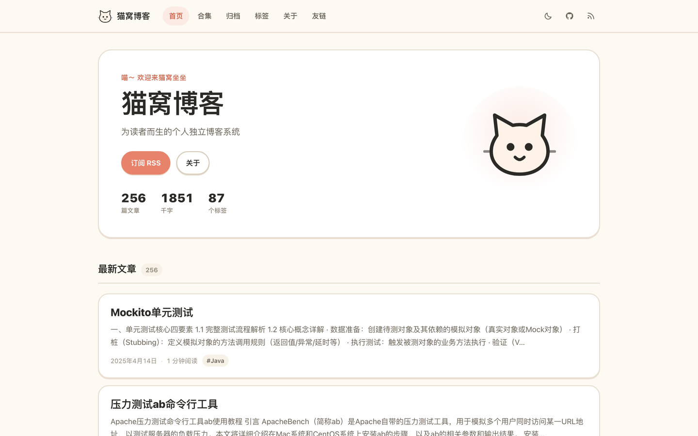

<div align="center">


# Maowo Blog

**A personal, independent blog for Cloudflare Workers.**
猫窝博客 —— 为读者而生的个人独立博客系统。

<p>
  <a href="README.zh-CN.md">🇨🇳 中文</a> · 🇺🇸 English
</p>

<p>
  
  
  
  
</p>

</div>



---

## Why another blog engine?

WordPress is heavy. Hexo and Hugo are fast but need a build step, a local toolchain and a deploy pipeline. Ghost is nice but
it is a product, not a file you own. Maowo Blog sits in between:

| | WordPress | Hexo / Hugo | **Maowo Blog** |
| --- | --- | --- | --- |
| Write in | browser (Gutenberg) | local editor + build | browser, Markdown |
| Publish | PHP + MySQL | static build + deploy | **one click, no build** |
| Hosting | VPS + DB | static host | **Cloudflare Workers (free tier)** |
| Comments | plugin zoo | third-party widget | **built-in, GitHub login** |
| Author accounts | multi-user CMS | n/a | **personal blog — no accounts** |
| Reader data | cookies, trackers | none | **no cookies, no trackers; only GitHub identity + verified email for account identification** |
| Cost | ~$5–20/mo | $0 | **$0 for most blogs** |

It is deliberately **not** a multi-user CMS: one person, one blog, no roles, no permission matrix, no plugin marketplace.
That is the feature.

## Features

- **Markdown writing in the browser.** Server-side rendering with the *same* module the live site uses, so preview equals production.
- **Reader-first reading experience.** 17.5px body, 1.9 line height, 720px measure, sticky table of contents, print stylesheet.
- **Stable numeric URLs.** A post lives at `/{13-digit-timestamp}` and never changes when the title changes.
- **Series (合集).** Group posts into a reading order that is simply publication time — no manual ordering to maintain.
- **Custom publish dates.** Backfill old posts or schedule the date you want; created/updated timestamps stay in the database.
- **Cute by shell, serious by content.** Rounded cards, a hand-drawn cat mascot, and a reading layout tuned for Chinese
  and Latin text alike. One look, done properly — no theme marketplace to configure.
- **Light and dark**, decided before first paint (inline script), following the system until the reader chooses.
- **Comments with GitHub login.** `read:user user:email` is requested: the GitHub identity (`github_id`, login, avatar)
  and the account's **verified primary email** are stored in the `users` table — the email is used only for account
  identification and site-operator contact (never shown, never returned by an API, never logged). Each account is
  limited to **10 comments per UTC day**, on top of a site-wide daily cap that stops scripted floods. Optional
  "your blog URL" field keeps the independent-blog web-ring culture (comment → return visit → backlink).
- **Sensitive-word blocking.** Upload a txt list in `/admin/settings` (one word per line, `# 政治` starts a category).
  Matched comments are rejected with a generic "inappropriate content" message and never reach the database or your
  daily quota. The list lives in D1, **not in this repo** (political/sexual vocabulary should not be published),
  is capped at 5000 words, and matching normalizes whitespace/punctuation/fullwidth first.
- **Agent-ready API.** `/admin/migrate` shows one copy-pasteable prompt; Codex / Claude / WorkBuddy then write,
  publish and migrate posts through the same `/api/admin/*` endpoints the UI uses — no second protocol.
- **One-click export**: the whole site as JSON. Moving in must not mean being locked in.
- **Deployment = configuration.** Language (`zh` / `en`) and admin credentials are environment variables, not runtime toggles.
- **Only D1 + R2.** No KV, no Queues, no Durable Objects, no crons. Edge cache via the Cache API.
- **SEO for free**: RSS with full content, sitemap, robots, canonical URLs, Open Graph tags.

## Deploy

> Requirements: a Cloudflare account and Node.js 20+.

### 1. Create the resources

```bash
git clone https://github.com/onblog/maowo-blog.git
cd maowo-blog
pnpm install

npx wrangler d1 create miao-blog-db        # copy the database_id
npx wrangler r2 bucket create miao-blog-media
```

Put the `database_id` into `wrangler.jsonc` (both the top-level and the `production` block).

### 2. Apply the schema

```bash
npx wrangler d1 migrations apply miao-blog-db --remote
```

### 3. Set the secrets

```bash
npx wrangler secret put GITHUB_CLIENT_ID    # for comments
npx wrangler secret put GITHUB_CLIENT_SECRET
```

The admin account needs **no** secrets: it lives in the D1 table `admin_credentials`
(migration `0007`). The first request to `/admin` seeds it as `admin` / `admin`, and the server then
forces you to change it before any other admin page or endpoint will work.

Create a GitHub OAuth App at <https://github.com/settings/developers> with the callback URL
`https://YOUR_DOMAIN/api/auth/github/callback`. GitHub allows **one** callback per app, so create a second app for local
development (`http://127.0.0.1:8789/api/auth/github/callback`).

### 4. Deploy

```bash
npx wrangler deploy --env production
```

Workers Builds does this on every push to `main`, in about **1–3 minutes**. To check whether a push
actually went live, use the dashboard's **Workers → maowo-blog → Builds** (one build per commit, with
duration and failure logs) or `npx wrangler versions list --name maowo-blog | grep Created | tail -3`.
Do **not** use `wrangler deployments list`: it only reflects deployments it created itself, so a
Workers Builds deploy leaves it looking unchanged.

`pnpm deploy` and Workers Builds both end up in `wrangler deploy`, which runs the `build.command` in
`wrangler.jsonc` first. That command bundles Mermaid into `public/vendor/mermaid.min.js` — a generated
file (3 MB, git-ignored) that has to exist **before** the static assets are uploaded. Losing it is not
loud: every diagram silently degrades into a code block, so the bundle is built on every deploy rather
than by hand. If you ever need it on its own, run `pnpm build` (same command).

Then open `/admin`, sign in with `admin` / `admin`, change the credentials when asked, and write your
first post.

### Configuration reference

| Variable | Required | Default | Notes |
| --- | --- | --- | --- |
| `SITE_URL` | yes | — | Absolute site URL. Derives the OAuth `redirect_uri`. |
| `SITE_LOCALE` | no | `zh` | UI language, **fixed at deploy time**. `zh` or `en`. |
| `GITHUB_CLIENT_ID` | for comments | — | Public value; safe in `vars`. |
| `GITHUB_CLIENT_SECRET` | for comments | — | **Secret.** Never commit it. |

`SITE_URL` is deliberately **not** in `wrangler.jsonc`: Workers Builds runs a plain `wrangler deploy`
(no `--env production`), so anything in the top-level `vars` block is stamped onto production as-is.
Instead it lives in two places — `.dev.vars` for local dev (see `.dev.vars.example`) and the Worker's
variables in the Cloudflare dashboard for production (Settings → Variables and Secrets). It is a plain
text value, not a secret:

```bash
# write it once to the deployed Worker (the value never enters git; keep_vars retains it afterwards)
npx wrangler deploy --var SITE_URL:https://YOUR_DOMAIN
```

Getting it wrong fails silently and pollutes every URL the site emits: `canonical`, `og:url`,
`sitemap.xml`, the Sitemap line in `robots.txt`, links inside the RSS feed, and the GitHub OAuth
callback. One line checks it after a deploy:

```bash
curl -s https://YOUR_DOMAIN/robots.txt | grep Sitemap   # must show the production domain
```

`wrangler.jsonc` sets `keep_vars`, so a dashboard-managed variable survives later `wrangler deploy`
runs — it only has to be set once.

The admin username and password are stored in D1 (`admin_credentials`, single row) and changed under
`/admin/account` — not through environment variables. The default `admin` / `admin` must be replaced
on first login.

Tune the site in `/admin/settings`: name, tagline, author bio, avatar, links, **colour mode (`auto` / `light` / `dark`)**, comments on/off.

## Migrate with an agent

Open `/admin/migrate`, copy the prompt, replace `<ADMIN_USER>` / `<ADMIN_PASS>`, and hand it to your agent.
The prompt only describes the site's existing HTTP API — the very endpoints `/admin` itself calls:

| Method | Path | Purpose |
| --- | --- | --- |
| `POST` | `/api/admin/login` | Sign in, receive the `miao_admin` cookie |
| `GET` | `/api/admin/posts` | List posts (id, slug, title, status) |
| `GET` | `/api/admin/posts/:id` | Read one post with `content_md` |
| `POST` / `PUT` | `/api/admin/posts` | Create / replace a post |
| `DELETE` | `/api/admin/posts/:id` | Delete a post |
| `POST` | `/api/admin/preview` | Render Markdown to HTML |
| `GET` | `/api/admin/export` | Export every post as JSON |

There is no agent-only protocol and no special token: the agent logs in like the admin page does.

**Export** — `GET /api/admin/export` returns `{ site, posts: [...] }`, the whole site in one JSON file.

## Project structure

```
src/
├── index.ts              Worker entry
├── site.tsx              Hono app: middleware order + route registration
├── lib/                  markdown, i18n, cookies, session, slug, formatting
├── middleware/           request id, guards, request context
├── routes/               pages, admin, api, auth, prefs, media, feed/sitemap
├── services/             posts, comments, site, tags, github
└── views/                SSR components (layout, home, post, admin)
migrations/               D1 schema
public/                   styles.css, app.js, admin.js, mascot + favicon
tests/                    unit tests (vitest)
```

## Design notes

- **No frontend framework.** Hono JSX renders HTML on the edge; ~10KB of vanilla JS handles theme, comments and the editor.
- **No WYSIWYG.** Markdown only — the server is the single renderer, so XSS is closed by `html: false` rather than by a sanitizer.
- **No KV.** Blog reads are one indexed D1 query; the Cache API covers hot paths without a second paid resource.
- **Comments are plain text**, rendered escaped with `white-space: pre-wrap`. No Markdown, no HTML, no injection surface.
- Full rationale: [`docs/en/DESIGN.md`](docs/en/DESIGN.md).

## FAQ

**Multiple authors?** No. Fork it and add a `users` table if you really need it — the schema is deliberately small.

**Git as the content source?** Not supported. Content lives in D1; the agent prompt at `/admin/migrate` covers the migration path.

**Will my comments survive a move?** Comments are part of the export JSON.

**Is Cloudflare required?** Yes, the runtime is Workers with D1 and R2 bindings.

**AI?** Not used for comment moderation — GitHub login (real identities) plus 10 comments per account per day and a
site-wide daily cap are enough. An optional Workers AI binding stays declared for your own extensions; without it,
nothing breaks.

## License

[AGPL-3.0-only](LICENSE).

Commercial use that cannot comply with AGPL (closed-source redistribution, SaaS without publishing modifications)
requires a commercial license — open an issue or contact the maintainer.

---

<div align="center">
Made for readers · 为读者而做 🐾
</div>
